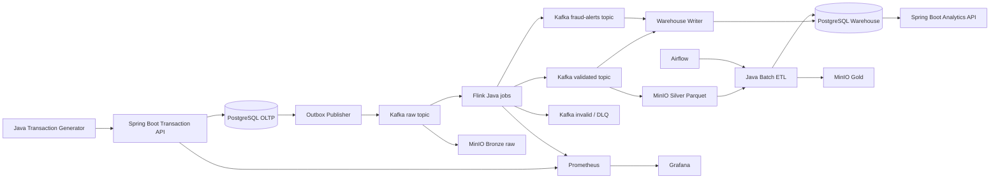

# IMPLEMENTATION — Java Real-Time Banking Data Platform

> **Mục tiêu:** Xây dựng nền tảng Data Engineering end-to-end bằng Java, xử lý giao dịch ngân hàng giả lập theo thời gian thực, lưu dữ liệu vào Data Lake và Data Warehouse, tạo báo cáo định kỳ, giám sát và kiểm thử hệ thống.
>
> **Phạm vi:** Dự án portfolio chạy local bằng Docker Compose; **không xử lý tiền thật, không kết nối hệ thống ngân hàng thật**. Các giao dịch chỉ là dữ liệu mô phỏng.

## 0. Trạng thái hiện tại và nguyên tắc đọc tài liệu

Tài liệu này là **implementation plan**, không phải bằng chứng rằng các thành phần đã tồn tại hoặc đã chạy thành công. Snapshot repository tại **2026-10-16**:

| Hạng mục | Trạng thái đã xác nhận | Việc cần làm trước khi coi là hoàn thành |
|---|---|---|
| Maven | Parent multi-module đã khai báo 9 modules, Java 21 và dependency BOM | Tiếp tục pin dependency/image theo compatibility matrix khi mỗi phase thêm runtime |
| Java | Maven compiler, CI và Flink image đều chốt Java 21; local Maven dùng OpenJDK 21.0.12.1 | Giữ Java 21 làm baseline và kiểm tra lại khi nâng Flink/connector |
| Source modules | Phase 0–5 đã có contracts/migrations, transaction API, generator, outbox publisher, Kafka và Flink streaming | Lake, warehouse, analytics và batch vẫn là planned work |
| Build baseline | Full reactor `mvn verify` pass 35 tests; Compose/script validation và live Phase 5 smoke đều pass | CI phải tiếp tục tái lập Maven + Compose config; downstream modules rỗng chưa được tính là implemented |
| Runtime/deployment | Compose đã chạy PostgreSQL, Kafka KRaft, API/publisher và Flink JobManager/TaskManager; smoke test xác nhận checkpoint recovery sau restart | Lake, warehouse và full-platform E2E vẫn chưa được triển khai |

Các mục trong tài liệu dùng ba trạng thái: **planned** (kế hoạch), **implemented** (đã có code/config), và **verified** (đã chạy kiểm chứng). Chỉ được đánh dấu `verified` khi có lệnh, log hoặc artifact tái hiện được. Không dùng số liệu benchmark mục tiêu như số liệu thực tế.

### 0.1 Thứ tự phụ thuộc bắt buộc

```text
compatibility matrix
  → parent Maven/modules + common contracts
  → schema/migrations + Docker foundation
  → transaction API + outbox
  → Kafka + publisher
  → Flink validation/dedup
  → lake/warehouse sinks
  → batch/analytics/observability
  → E2E, failure drills, benchmark và release
```

Không bắt đầu phase downstream khi exit gate của phase upstream chưa đạt. Mỗi phase phải ghi lại: commit, lệnh kiểm tra, kết quả, known limitations và artifact/evidence tương ứng.

## 1. Mục tiêu, phạm vi và tiêu chí thành công

### 1.1 Chức năng

1. Nhận yêu cầu giao dịch qua Spring Boot REST API; lưu giao dịch và outbox event cùng một PostgreSQL transaction.
2. Outbox publisher chuyển sự kiện sang Kafka với retry và khả năng phát lại an toàn.
3. Flink đọc Kafka, validate, deduplicate, phát hiện fraud theo luật, tạo aggregation theo event time.
4. Ghi raw events vào MinIO (Bronze), dữ liệu chuẩn hóa vào Silver, kết quả tổng hợp vào Gold; ưu tiên Parquet.
5. Nạp dữ liệu phân tích vào PostgreSQL warehouse với cơ chế idempotent/upsert.
6. Chạy Java batch ETL theo lịch bằng Airflow; cung cấp Analytics API.
7. Theo dõi metrics và cảnh báo bằng Prometheus/Grafana.
8. Build, test, deploy local qua Docker Compose và GitHub Actions.

### 1.2 Ngoài phạm vi MVP

- Không có chuyển tiền thật, ledger kế toán ngân hàng đạt chuẩn, KYC/AML thật, PCI DSS certification hay mô hình ML production.
- Không triển khai Kubernetes, HA nhiều node hoặc multi-region trong bản đầu.
- Không cam kết exactly-once end-to-end nếu sink/transaction boundary chưa được kiểm chứng.

### 1.3 Acceptance criteria

- `docker compose up -d --build` khởi chạy hạ tầng; bootstrap/migrations và Flink job được chạy bằng lệnh/script đã tài liệu hóa.
- Gửi 1 giao dịch hợp lệ → có bản ghi OLTP + outbox → Kafka raw → Flink → warehouse và MinIO; truy vấn được bằng Analytics API.
- Giao dịch lỗi validation được phân luồng đúng, có lý do lỗi, không làm chết job.
- Khởi động lại publisher/Flink không tạo giao dịch trùng trong warehouse.
- Fraud rule tạo alert khi thỏa điều kiện; có kiểm thử tự động.
- Batch job chạy lại cùng partition/date không nhân đôi số liệu.
- Có dashboard Kafka lag, Flink checkpoint, API latency, DB health, storage.
- Có README, sơ đồ kiến trúc, ERD, API examples, runbook và kết quả benchmark có phương pháp đo.

## 2. Công nghệ và chiến lược phiên bản

| Layer | Công nghệ | Ghi chú |
|---|---|---|
| Application | Java 21, Spring Boot | Java 21 cho API, publisher, generator, analytics |
| Build | Maven | Maven 3.8.7 hiện có đủ để bắt đầu; kiểm tra yêu cầu plugin trước khi pin |
| Messaging | Apache Kafka | KRaft, single broker cho local |
| Stream processing | Apache Flink (Java DataStream API) | **Kiểm tra ma trận hỗ trợ Java trước khi chốt runtime**; có thể build/run Flink job bằng JDK 17 riêng |
| OLTP / Warehouse | PostgreSQL | Hai database tách biệt, có thể cùng instance local |
| Object storage | MinIO | S3-compatible; bucket riêng cho dự án |
| Data format | JSON cho MVP, Parquet cho lake | Avro/Schema Registry ở giai đoạn nâng cao |
| Scheduling | Apache Airflow | DAG Python chỉ điều phối Java batch executable |
| Observability | Micrometer, Prometheus, Grafana | Export metrics và dashboards |
| Testing | JUnit 5, Testcontainers | Unit + integration + end-to-end |
| Delivery | Docker Compose, GitHub Actions | Local deployment + CI |

**Quy tắc pin version:** Trước khi viết `pom.xml` và `docker-compose.yml`, kiểm tra compatibility của Spring Boot, Kafka clients, Flink connector, JDK, PostgreSQL driver và container images theo tài liệu chính thức. Pin **phiên bản cụ thể** trong `docs/compatibility-matrix.md`, tránh `latest`. Không giả định Flink chạy ổn định trên Java 21 chỉ vì API service dùng Java 21.

## 3. Kiến trúc tổng thể



**Quan trọng:** Diagram biểu diễn các luồng logic. Mỗi connector/consumer/sink phải được hiện thực riêng. Không mặc định Flink có thể ghi trực tiếp mọi loại sink với exactly-once. MVP có thể dùng Kafka consumer Java độc lập để ghi warehouse và MinIO; các sink này cần idempotency. Với raw archival, một consumer độc lập đọc raw topic để lưu Bronze, bảo đảm không mất payload do validation.

### 3.1 Luồng giao dịch chuẩn

1. API nhận request, xác thực schema và idempotency key.
2. PostgreSQL transaction ghi `transactions` và `outbox_events`; commit đồng thời.
3. Outbox publisher đọc các row chưa publish, gửi Kafka; chỉ đánh dấu published sau khi broker ack.
4. Flink consume raw, parse schema, validate, deduplicate, xử lý event time, tính fraud alerts và aggregates.
5. Kafka consumers/sink jobs ghi Silver, warehouse và alerts; sử dụng transaction_id/event_id làm khóa chống trùng.
6. Airflow chạy Java batch để tổng hợp ngày, reconcile số liệu và sinh Gold/report.
7. Analytics API đọc warehouse (không query OLTP để làm dashboard nặng).

### 3.2 Delivery semantics

- Outbox publisher: **at-least-once**; crash sau Kafka ack trước khi update DB có thể phát trùng.
- Flink: checkpoint và state giúp khôi phục; bảo đảm của toàn pipeline phụ thuộc sink.
- Warehouse: `INSERT ... ON CONFLICT DO UPDATE/NOTHING` và unique keys để có **effectively-once business results**.
- Object storage: dùng deterministic object paths + manifest/commit protocol; tránh coi một lần PUT là exactly-once cho toàn luồng.
- Event order: partition Kafka theo `account_id`; chỉ bảo đảm thứ tự **trong một partition**.

## 4. Repository structure

```text
java-banking-data-platform/
├── pom.xml                         # Maven parent (packaging=pom)
├── .env.example
├── .gitignore
├── docker-compose.yml
├── Makefile
├── README.md
├── docs/
│   ├── IMPLEMENTATION.md
│   ├── architecture.md
│   ├── compatibility-matrix.md
│   ├── data-contracts.md
│   ├── data-model.md
│   ├── runbook.md
│   ├── security.md
│   └── benchmarks.md
├── common/
│   ├── pom.xml
│   └── src/main/java/io/github/hquan07/banking/common/
├── services/
│   ├── transaction-service/
│   ├── transaction-generator/
│   ├── outbox-publisher/
│   ├── streaming-processor/
│   ├── lake-writer/
│   ├── warehouse-writer/
│   ├── batch-processor/
│   └── analytics-service/
├── infrastructure/
│   ├── postgres/init/
│   ├── kafka/
│   ├── minio/
│   ├── prometheus/
│   └── grafana/
├── orchestration/airflow/dags/
├── warehouse/
│   ├── migrations/
│   └── queries/
├── scripts/
│   ├── bootstrap.sh
│   ├── create-topics.sh
│   ├── submit-flink-job.sh
│   ├── smoke-test.sh
│   └── reconcile.sh
├── tests/e2e/
└── .github/workflows/ci.yml
```

**Maven parent:** `<packaging>pom</packaging>`, khai báo `<modules>` trỏ đúng các thư mục con (ví dụ `services/transaction-service`), thống nhất plugin versions và dependency management. `common` chứa DTO/schema dùng chung, tránh dùng chung JPA entities giữa các bounded contexts.

### 4.1 Quy tắc cấu hình và secrets

- `.env.example` chỉ chứa tên biến, giá trị local vô hại và comment; `.env` không được commit.
- Mỗi service phải có cấu hình typed/validated khi khởi động; thiếu biến bắt buộc phải fail fast với thông báo không chứa secret.
- Tách cấu hình `local`, `test` và `ci`; không để test phụ thuộc vào dữ liệu hoặc container đang chạy từ máy developer.
- Tên host nội bộ Docker phải dùng service name ổn định, ví dụ `kafka`, không dùng tên container ngẫu nhiên hoặc hostname có dấu gạch dưới.
- Mọi thay đổi config ảnh hưởng contract, retention, checkpoint hoặc schema phải được ghi trong changelog/ADR ngắn.

## 5. Phase 0 — Prerequisites và khởi tạo

### 5.1 Kiểm tra môi trường Ubuntu 24.04

```bash
java -version
javac -version
echo "$JAVA_HOME"
mvn -version
docker --version
docker compose version
git --version
```

Nếu cần chọn Java 21 cho Spring Boot:

```bash
sudo update-alternatives --config java
sudo update-alternatives --config javac
# Trong ~/.bashrc, chỉ giữ một cặp export:
export JAVA_HOME=/usr/lib/jvm/java-21-openjdk-amd64
export PATH="$JAVA_HOME/bin:$PATH"
source ~/.bashrc
```

**Flink:** kiểm tra phiên bản mục tiêu hỗ trợ JDK nào; dùng Docker image/JDK riêng cho Flink nếu cần. Tránh đổi JDK toàn hệ thống chỉ để chạy một service.

### 5.2 Bootstrap

```bash
mkdir -p java-banking-data-platform
cd java-banking-data-platform
git init
mkdir -p common services infrastructure/{postgres/init,kafka,minio,prometheus,grafana} \
  orchestration/airflow/dags warehouse/{migrations,queries} scripts tests/e2e docs .github/workflows
```

**Deliverables:** parent `pom.xml`, module skeleton, `.gitignore`, `.env.example`, README có lệnh chạy. **Exit gate:** `mvn -B clean verify` thành công với modules rỗng/tối thiểu.

### 5.3 Compatibility và baseline bắt buộc

`docs/compatibility-matrix.md` phải chốt tối thiểu: JDK, Maven compiler/toolchains, Spring Boot, Flink, Kafka broker/client, PostgreSQL, MinIO, Airflow, Docker images, Testcontainers và plugin Maven. Mỗi dòng cần version cụ thể, nguồn xác minh, ngày kiểm tra, Java runtime được hỗ trợ và ghi chú known issue.

Trước khi tạo module đầu tiên, kiểm tra đồng thời:

1. `java -version`, `mvn -version`, Docker và Compose.
2. `mvn -B -ntp validate` với POM thực tế.
3. Khả năng tải dependency/plugin trong môi trường CI; nếu dùng mirror/cache thì tài liệu hóa mirror đó.
4. Flink job chạy bằng JDK/container được hỗ trợ, độc lập với JDK của Spring Boot API nếu cần.

Không coi việc đổi `maven.compiler.source` là đã giải quyết tương thích; phải kiểm tra compile, test và runtime của từng module.

## 6. Phase 1 — Domain model, data contracts và database

### 6.1 Business entities

- `customers`: customer_id, status, created_at.
- `accounts`: account_id, customer_id, currency, status, created_at.
- `transactions`: transaction_id, account_id, transaction_type, amount, currency, status, occurred_at, created_at, idempotency_key.
- `outbox_events`: event_id, aggregate_id, event_type, schema_version, payload, created_at, published_at, attempts.
- `fraud_alerts`: alert_id, transaction_id, rule_code, severity, detected_at.

**MVP domain simplification:** `TRANSFER` không thực hiện debit/credit ledger thật. Nếu cần mô phỏng chuyển giữa hai tài khoản, bổ sung `source_account_id`, `destination_account_id` và tách business transaction khỏi analytics event.

### 6.2 OLTP SQL gợi ý

```sql
CREATE TABLE transactions (
    transaction_id UUID PRIMARY KEY,
    account_id VARCHAR(64) NOT NULL,
    transaction_type VARCHAR(32) NOT NULL,
    amount NUMERIC(19, 2) NOT NULL CHECK (amount > 0),
    currency CHAR(3) NOT NULL,
    status VARCHAR(24) NOT NULL,
    occurred_at TIMESTAMPTZ NOT NULL,
    created_at TIMESTAMPTZ NOT NULL DEFAULT NOW(),
    idempotency_key VARCHAR(128) NOT NULL UNIQUE
);

CREATE TABLE outbox_events (
    event_id UUID PRIMARY KEY,
    aggregate_id UUID NOT NULL,
    event_type VARCHAR(100) NOT NULL,
    schema_version INT NOT NULL,
    payload JSONB NOT NULL,
    created_at TIMESTAMPTZ NOT NULL DEFAULT NOW(),
    published_at TIMESTAMPTZ,
    attempts INT NOT NULL DEFAULT 0
);
CREATE INDEX idx_outbox_unpublished
    ON outbox_events (created_at) WHERE published_at IS NULL;
```

Dùng Flyway migrations thay vì tạo schema bằng tay trong ứng dụng. Trong production, cần cân nhắc account FK, lifecycle states và retention/partitioning.

Schema tối thiểu còn phải quy định rõ:

- `customers` và `accounts` với unique key, trạng thái hợp lệ, foreign key và quy tắc soft-delete/lifecycle.
- `transactions.request_fingerprint` hoặc bảng idempotency riêng để cùng một key với payload khác trả `409`, không âm thầm trả kết quả cũ.
- `outbox_events`: `attempts`, `next_attempt_at`, `last_error`, `locked_until/claim_token`, `published_at`; không dùng một worker polling đơn giản có thể claim trùng.
- `fraud_alerts` với unique business key, ví dụ `transaction_id + rule_code + window_id`, để retry không nhân đôi alert.
- Bảng audit/reconciliation cho batch và sink: run id, source range, input/output counts, checksum hoặc aggregate sums, status, error và timestamps.

Mỗi migration phải có forward-only version, rollback/recovery note và test chạy từ database rỗng. Không sửa migration đã chạy ở shared environment; tạo version mới.

### 6.3 Kafka event contract

```json
{
  "event_id": "e16bc5b2-7e6b-4c83-9172-36f6d99a79b8",
  "event_type": "transaction.created",
  "schema_version": 1,
  "transaction_id": "b1aeb84d-40bd-40a6-b2c7-a22ddc71dcb9",
  "account_id": "ACC10001",
  "transaction_type": "TRANSFER",
  "amount": "1500000.00",
  "currency": "VND",
  "status": "SUCCESS",
  "occurred_at": "2026-10-16T03:30:00Z",
  "produced_at": "2026-10-16T03:30:01Z"
}
```

- Dùng decimal string hoặc schema decimal logical type; **không dùng float/double cho tiền**.
- Dùng UTC ISO-8601; phân biệt `occurred_at` (event time) và `produced_at` (ingestion time).
- Có `event_id`, `schema_version`, correlation/trace ID nếu cần.
- Không phát PII nhạy cảm vào Kafka; dùng ID giả lập.

Envelope lỗi và DLQ cũng là contract, không chỉ là chuỗi log. Tối thiểu phải có `event_id` (nếu parse được), `original_topic`, `original_partition`, `original_offset`, `failure_class`, `failure_code`, `failure_message` đã loại secret, `first_failed_at`, `retry_count`, `schema_version`, `payload_hash` và `replay_status`. Phân biệt lỗi business không retry, lỗi schema cần sửa producer, và lỗi hạ tầng có thể retry. Tài liệu hóa compatibility rule: consumer mới đọc được payload cũ; field mới phải có default/optional; field bị bỏ phải có deprecation window.

**Exit gate:** ERD + migrations + contract tests + unique constraints hoạt động.

**Trạng thái 2026-10-16:** đã triển khai hai JSON Schema v1 và Java records tương ứng, hai Flyway migrations, ERD/invariant/recovery notes, cùng 7 tests. PostgreSQL Testcontainers đã áp dụng schema rỗng lên v2 và xác nhận các constraint idempotency, amount, outbox claim và fraud business key. Đây chưa phải bằng chứng Phase 2 API hoặc runtime deployment hoạt động.

## 7. Phase 2 — Transaction Service (Spring Boot)

### 7.1 API endpoints

| Method | Path | Mục đích |
|---|---|---|
| POST | `/api/v1/transactions` | Tạo giao dịch mô phỏng |
| GET | `/api/v1/transactions/{id}` | Tra cứu trạng thái |
| GET | `/actuator/health` | Health check |
| GET | `/actuator/prometheus` | Metrics (internal only) |

Request mẫu:

```bash
curl -X POST http://localhost:8080/api/v1/transactions \
  -H 'Content-Type: application/json' \
  -H 'Idempotency-Key: demo-txn-001' \
  -d '{"accountId":"ACC10001","transactionType":"TRANSFER","amount":"1500000.00","currency":"VND"}'
```

### 7.2 Implementation tasks

1. Spring Initializr/module Maven với Web, Validation, Data JPA hoặc JDBC, PostgreSQL, Actuator, Flyway.
2. DTO `TransactionRequest` với Bean Validation; service dùng `BigDecimal`.
3. Repository và migration; transaction boundary `@Transactional` cho ghi transaction + outbox.
4. Xử lý duplicate `Idempotency-Key`: trả lại kết quả cũ thay vì tạo giao dịch mới; lưu fingerprint request để phát hiện key bị tái sử dụng với payload khác.
5. Chuẩn hóa errors (400, 404, 409, 500), structured logging, correlation ID.
6. Test API với MockMvc và Testcontainers PostgreSQL.

Response contract cần chốt trước khi viết client:

- `202 Accepted` nếu API chỉ nhận và xử lý bất đồng bộ, hoặc `201 Created` nếu transaction đã được commit; không dùng lẫn hai nghĩa.
- Response phải có `transactionId`, `status`, `createdAt`, `correlationId`; không trả payload nội bộ của outbox.
- `400` cho validation, `404` cho resource không tồn tại, `409` cho idempotency conflict, `429` cho rate limit và `503` khi dependency không sẵn sàng.
- Error body thống nhất gồm `code`, `message`, `correlationId`, `details` an toàn; không lộ SQL, stack trace, token hoặc request secret.
- `Idempotency-Key` phải có scope rõ ràng (client/tenant), TTL/retention, giới hạn kích thước và quy tắc retry khi request trước còn `IN_PROGRESS`.
- Health/readiness/liveness tách biệt; readiness phải phản ánh dependency cần cho request hiện tại, còn metrics endpoint chỉ mở trong network nội bộ.

**Exit gate:** cùng một idempotency key gửi lại không sinh giao dịch/outbox trùng; rollback DB khiến cả hai bảng không có bản ghi.

**Trạng thái 2026-10-16:** implemented và integration-tested trên PostgreSQL 17.11 Testcontainers. API dùng Spring JDBC, Bean Validation, Flyway, Actuator/Prometheus, correlation ID và error envelope an toàn. Request mới commit transaction + outbox rồi trả `201`; retry cùng key/payload trả `200`; cùng key/payload khác trả `409`. Idempotency key có global scope, tối đa 128 ký tự và được giữ cùng transaction, chưa có TTL tự động. PostgreSQL advisory transaction lock xử lý retry đồng thời; unique constraint vẫn là invariant cuối. Test cưỡng bức outbox insert lỗi đã xác nhận cả transaction và outbox đều rollback. Chưa có Compose/live smoke test, vì vậy không coi deployment hoặc E2E pipeline là verified.

## 8. Phase 3 — Transaction Generator và Outbox Publisher

### 8.1 Generator

- Java CLI/service sinh giao dịch với cấu hình `TPS`, `DURATION_SECONDS`, `SEED`, số account.
- Phân phối: 90–95% hợp lệ, phần còn lại invalid/large amount/burst traffic để kiểm thử.
- Metrics: request count, success rate, p50/p95/p99 latency, throughput.
- Không ghi log payload chứa dữ liệu nhạy cảm.

### 8.2 Publisher

- Poll outbox theo batch (`FOR UPDATE SKIP LOCKED` khi có nhiều worker); tránh giữ DB lock trong lúc chờ network lâu bằng thiết kế claim/lease phù hợp.
- Kafka key = `account_id`; producer bật idempotence và `acks=all` (trong môi trường multi-broker mới có replication thực sự).
- Chỉ đánh dấu published sau khi Kafka xác nhận; retry với exponential backoff và jitter.
- Khi publish thất bại nhiều lần, giữ row để điều tra/retry, không xóa sự kiện.
- Metrics: unpublished backlog, publish latency, retry count, failures.

**Exit gate:** tắt Kafka trong lúc tạo giao dịch → outbox tồn tại; bật Kafka → backlog được publish; crash sau ack có thể phát trùng nhưng downstream không nhân đôi.

**Trạng thái 2026-10-16:** implemented và integration-tested với PostgreSQL 17.11 cùng Kafka 4.3.1 Testcontainers. Generator chạy bằng Java 21, nhận TPS/duration/seed/danh sách account, tạo workload xác định gồm 91% normal, 2% large amount, 2% idempotent retry, 3% invalid amount và 2% currency mismatch; burst được cấu hình độc lập. Báo cáo cuối gồm tổng request, success/failure theo HTTP/transport, p50/p95/p99 và throughput, không log payload. Publisher claim batch bằng `FOR UPDATE SKIP LOCKED`, dùng lease ngắn và không giữ transaction DB khi chờ Kafka; key là `account_id`, producer bật idempotence và `acks=all`, chỉ cập nhật `published_at` sau ACK. Lỗi publish giữ nguyên row, lưu lỗi đã rút gọn và retry exponential backoff có jitter. Test đã xác nhận outage giữ backlog, Kafka phục hồi thì publish lại, claim đồng thời không trùng và lease hết hạn có thể được reclaim. Duplicate sau ACK nhưng trước DB update vẫn là khả năng có chủ đích của at-least-once; dedup downstream thuộc Phase 5. Compose/topic bootstrap/live pipeline vẫn thuộc Phase 4.

## Cross-cutting — Data Sources, nguồn dữ liệu, tải và tích hợp

> **Quyết định:** kết hợp **synthetic data** cho streaming liên tục và **public historical datasets** cho backfill, replay, kiểm thử fraud/AML. Toàn bộ là dữ liệu mô phỏng hoặc công khai; không sử dụng dữ liệu ngân hàng thật.

### 8A.1 Danh mục nguồn dữ liệu

| Dataset | Nguồn / đường dẫn | Vai trò | Lưu ý |
|---|---|---|---|
| Customers | Java DataFaker — https://www.datafaker.net/ | Sinh khách hàng giả lập | Không dùng thông tin định danh thật |
| Accounts | Java generator + business rules | Sinh tài khoản và quan hệ customer–account | Giữ khóa ngoại nhất quán |
| Merchants / Devices | Java DataFaker + generator | Metadata cho thanh toán và phát hiện bất thường | ID ổn định theo seed |
| Real-time Transactions | Java Transaction Generator | Luồng sự kiện liên tục vào Transaction API | Điều chỉnh TPS, seed, fraud scenarios |
| PaySim | https://www.kaggle.com/datasets/ealaxi/paysim1 | Giao dịch lịch sử, replay Kafka, fraud testing | Synthetic mobile-money; không phải dữ liệu ngân hàng thật |
| Credit Card Fraud Detection | https://www.kaggle.com/datasets/mlg-ulb/creditcardfraud | Benchmark fraud trên dữ liệu đã ẩn danh | Đặc trưng PCA; không join trực tiếp với accounts |
| IBM AMLSim | https://github.com/IBM/AMLSim | Sinh dữ liệu và kịch bản AML | Kiểm tra license, dependencies và schema trước khi chạy |
| Exchange rates (optional) | Bảng tỷ giá mô phỏng theo ngày | Quy đổi và báo cáo đa tiền tệ | Không giả định tỷ giá thực |

**Khuyến nghị MVP:** Java generator + PaySim là đủ. Credit Card Fraud Detection và AMLSim thuộc giai đoạn mở rộng, không chặn tiến độ MVP.

### 8A.2 Cách lấy dữ liệu (ưu tiên tải thủ công)

1. Mở trang PaySim trên Kaggle, đăng nhập nếu được yêu cầu, tải file CSV về máy bằng trình duyệt (không cần Kaggle API).
2. Đặt file vào `data/raw/paysim/` và giữ nguyên bản gốc. Không commit dataset dung lượng lớn vào Git.
3. Tải Credit Card Fraud Detection thủ công khi thực hiện fraud benchmark; đặt tại `data/raw/creditcard/`.
4. Với AMLSim, tham khảo README tại GitHub, chạy generator ở môi trường riêng hoặc nhập file output đã tạo vào `data/raw/amlsim/`.
5. Ghi nguồn, URL, ngày tải, license/terms, số bản ghi, checksum SHA-256, schema và phiên bản trong `docs/datasets.md`.
6. Upload dữ liệu thô lên MinIO `bronze/external/{source}/ingest_date=YYYY-MM-DD/` qua script bootstrap; tránh đổi nội dung raw file.

`.gitignore` cần chứa:

```gitignore
data/raw/
data/generated/
*.parquet
```

### 8A.3 Java Transaction Generator

Sử dụng Java 21, DataFaker, `SplittableRandom`/seed cố định và `ScheduledExecutorService` (hoặc rate limiter) để tạo các entity nhất quán. Không tạo ngẫu nhiên `account_id` không tồn tại.

```yaml
generator:
  enabled: true
  transactions-per-second: 100
  duration-seconds: 600
  seed: 1607
  customers: 10000
  accounts: 20000
  merchants: 1000
  fraud-probability: 0.01
  currency: VND
```

Ở 100 TPS, **lý thuyết** có 6.000 giao dịch/phút, 360.000 giao dịch/giờ, 8.640.000 giao dịch/ngày nếu duy trì liên tục; đây **không phải** số liệu throughput đã benchmark. Thử tải theo nấc 10 → 50 → 100 TPS trước khi tăng cao hơn.

Tạo các scenario: giao dịch bình thường, giá trị lớn, burst theo account, nhiều giao dịch thất bại, duplicate event, out-of-order event và event đến muộn. Fraud labels của generator là **ground truth giả lập**, không phải kết luận gian lận thực tế.

### 8A.4 Mapping PaySim sang canonical event

| PaySim CSV | Canonical field | Quy tắc |
|---|---|---|
| `step` | `event_time` | Dùng `simulation_start + step * 1 hour`, không coi là timestamp thật |
| `type` | `transaction_type` | Mapping có kiểm soát; giữ giá trị gốc khi không nhận diện |
| `amount` | `amount` | `BigDecimal`, kiểm tra > 0 và scale |
| `nameOrig` | `source_account_id` | Prefix `PAYSIM_` để tránh trùng ID nội bộ |
| `nameDest` | `destination_account_id` | Prefix `PAYSIM_` |
| `isFraud` | `fraud_label` | Chỉ dùng để đánh giá; không dùng làm feature đầu vào detector |
| `isFlaggedFraud` | `source_flag` | Giữ riêng với nhãn gian lận |

PaySim không cung cấp currency theo schema CSV chuẩn: thêm `currency` như **giả định mô phỏng có tài liệu**, không diễn giải là dữ liệu gốc. `transaction_id` được sinh **ổn định** từ `(dataset_version, row_number)` hoặc hash canonical record kèm row index. Lưu `source_dataset`, `source_row_id`, `schema_version`, `ingested_at`, `event_time` để truy vết và deduplicate.

**Quan trọng:** PaySim, AMLSim và generator có các không gian ID khác nhau; không join customer/account xuyên nguồn nếu không có bảng mapping được xây dựng có chủ đích. Credit Card Fraud Detection chủ yếu dùng cho pipeline benchmark riêng vì không có customer/account ID tương thích.

### 8A.5 Hai pipeline ingest độc lập

```text
LIVE: Java Generator -> Spring Boot Transaction API -> PostgreSQL + Outbox
     -> Outbox Publisher -> Kafka raw -> Flink -> MinIO / Warehouse

HISTORICAL: PaySim CSV -> Java CSV Parser + Mapper -> MinIO Bronze
            -> Java CSV Replay Producer -> Kafka replay/raw -> Flink
            -> MinIO Silver/Gold -> Warehouse
```

- **Live API path:** sử dụng transactional outbox như thiết kế chính; không bỏ qua bước ghi OLTP.
- **Historical replay path:** cho phép publish trực tiếp Kafka qua producer riêng để benchmark ingestion; đánh dấu `source_type=HISTORICAL_REPLAY`, tránh giả vờ đó là giao dịch đã được hạch toán trong OLTP.
- Chọn **topic riêng** `banking.transactions.replay` cho lần chạy đầu để tránh lẫn KPI live; chỉ hợp nhất khi đã có source-aware routing.
- Hỗ trợ `--rate`, `--from-row`, `--max-records`, `--seed`, `--simulation-start`, `--run-id`.
- Giữ `event_time` mô phỏng tách khỏi `ingested_at` và `processing_time`; watermark phải xét độ trễ khi replay.
- Batch backfill vào warehouse cần upsert/dedup theo khóa ổn định để chạy lại không nhân đôi fact.

### 8A.6 Kiểm tra chất lượng dữ liệu và nghiệm thu

- **Schema:** kiểm tra các trường bắt buộc, kiểu dữ liệu, enum và phiên bản schema.
- **Referential integrity:** account/customer/merchant ID phải tồn tại đối với dữ liệu do generator sinh.
- **Validity:** amount dương, currency hợp lệ, timestamp parse được, status nhất quán.
- **Uniqueness:** `transaction_id` duy nhất trong mỗi namespace; replay cùng `run-id` không tăng số giao dịch duy nhất.
- **Reconciliation:** so sánh số dòng CSV đọc được, sự kiện publish/consume, số bản ghi hợp lệ/không hợp lệ và số fact warehouse.
- **Fraud testing:** đo precision, recall và false positive rate trên nhãn mô phỏng; tránh leakage từ `isFraud`.
- **Provenance:** ghi checksum, số dòng, mapping version, source và ingest run để có thể tái hiện.

**Exit gate nguồn dữ liệu:** (1) generator tạo ít nhất 10.000 giao dịch có tham chiếu hợp lệ; (2) import và replay thành công mẫu PaySim ít nhất 10.000 dòng; (3) có báo cáo reconciliation, lỗi schema chuyển DLQ, replay lại không nhân đôi fact; (4) raw dataset và dữ liệu sinh không bị commit lên Git.

## 9. Phase 4 — Kafka infrastructure

### 9.1 Topics

| Topic | Key | Mục đích | Gợi ý local partitions |
|---|---|---|---:|
| `banking.transactions.raw` | account_id | Events gốc | 3 |
| `banking.transactions.validated` | account_id | Events sạch | 3 |
| `banking.transactions.invalid` | event_id | Invalid records + reason | 3 |
| `banking.transactions.fraud-alerts` | account_id | Fraud signals | 3 |
| `banking.transactions.aggregates` | window key | Realtime aggregates | 3 |
| `banking.transactions.dlq` | event_id | Lỗi kỹ thuật không xử lý được | 3 |

Single broker local: replication factor = 1. Production: multi-broker và replication factor phù hợp, `min.insync.replicas`, ACL/TLS và retention policy.

### 9.2 Testing

- Producer → consumer roundtrip.
- Partition key consistency.
- Rebalance và restart consumer.
- Duplicate event và schema version không hợp lệ.
- Retryable vs non-retryable errors: invalid business payload → invalid topic; poison/technical failures → DLQ với metadata và policy reprocess.

**Exit gate:** topics tạo bằng script idempotent; consumer nhận sự kiện đúng key; restart không mất offset đã commit.

Topic governance phải ghi rõ owner, schema version, retention, cleanup policy, partition count, key contract, PII classification và replay policy. Với local single broker có thể dùng plaintext để giảm ma sát; mọi profile ngoài local phải bật TLS/ACL theo `docs/security.md`. Khi bật TLS, SAN/hostname nội bộ phải khớp service name `kafka`; không dùng `banking_kafka` làm hostname client.

**Trạng thái 2026-10-17:** implemented với `apache/kafka:4.3.1` chạy KRaft single-node, auto topic creation bị tắt, internal hostname cố định là `kafka` và host listener chỉ bind `127.0.0.1`. Sáu topic được quản lý từ `infrastructure/kafka/topics.tsv`; `scripts/create-topics.sh` tạo/cập nhật partition, retention và cleanup policy theo cách idempotent, đồng thời fail nếu topology hiện tại không thể thu hẹp an toàn. Compose đóng gói transaction service, publisher và generator bằng Java 21 image không chạy root; PostgreSQL/Kafka dùng named volume. `scripts/smoke-test.sh` kiểm tra topic bootstrap chạy lại, hai transaction cùng account đi cùng partition, Kafka key khớp `account_id`, outbox chỉ được đánh dấu sau publish, và consumer group restart tiếp tục từ committed offset. Invalid/DLQ topics đã được provision nhưng logic routing business/technical error thuộc Phase 5, chưa được nhận là implemented.

## 10. Phase 5 — Flink Java streaming

### 10.1 Jobs

1. **ValidationJob:** Kafka raw → parse, validate schema/fields → validated hoặc invalid.
2. **FraudDetectionJob:** validated → rules (large amount, velocity) → fraud-alerts.
3. **AggregationJob:** validated → event-time windows → aggregates topic.

Có thể gộp trong một Flink application nếu giúp đơn giản hóa checkpoint và deployment; tách khi cần scale/ownership độc lập.

### 10.2 Fraud rules mẫu

- `HIGH_VALUE`: `amount >= 100000000 VND`.
- `VELOCITY_60S`: cùng account có `> 10` giao dịch trong rolling 60 giây.
- `RAPID_FAILURES`: nhiều giao dịch failed trong cửa sổ ngắn (nếu generator tạo status phù hợp).

Các rule chỉ là **demo**, không được xem là hệ thống fraud/AML thật. Cần deduplicate trước khi tính velocity để duplicate Kafka không tạo false positive.

### 10.3 Event-time processing

- Watermark strategy với bounded out-of-orderness (ví dụ 10–30 giây; phải đo từ dữ liệu thực tế).
- Tumbling window 1 phút cho throughput/volume; sliding window cho velocity.
- Allowed lateness/late events handling; side output hoặc correction path cho events quá trễ.
- State TTL hợp lý, tránh state growth vô hạn.
- Checkpoint lưu vào durable MinIO/S3-compatible endpoint **sau khi kiểm chứng connector/config tương thích**; local filesystem chỉ dành cho demo không cần recovery bền vững.

### 10.4 Failure testing

- Kill/restart TaskManager/job giữa lúc ingest.
- Verify restore from checkpoint/savepoint.
- Inject out-of-order và duplicate events.
- So sánh expected vs actual aggregate counts.

**Exit gate:** valid/invalid routing đúng; alert theo rule; restart phục hồi state và không nhân đôi warehouse.

**Trạng thái 2026-10-17:** implemented và verified trong một Flink application với validation, dedup theo `event_id`, watermark bounded 15 giây, configurable partition idleness, late path 30 giây, `HIGH_VALUE`, sliding `VELOCITY_60S` và tumbling aggregate 1 phút theo currency. Kafka sinks dùng transaction gắn với checkpoint; operator UIDs ổn định và dedup state có test snapshot/restore. Source mặc định resume committed offsets với earliest fallback; isolated smoke run dùng group riêng và latest offsets. Compose pin Flink 2.1.3/Java 21 cùng Kafka connector 5.0.0-2.1 và Kafka client 4.2.0, lưu checkpoint trong named volume local và submit job theo cách idempotent. Full reactor pass 35 tests; hai live smoke runs liên tiếp đã xác nhận valid/invalid/late routing trên ba Kafka partitions, fraud/aggregate outputs và phục hồi state không phát lại duplicate sau TaskManager restart. Local filesystem checkpoint chỉ dành cho demo một host. Phần “không nhân đôi warehouse” chỉ có thể nghiệm thu đầy đủ ở Phase 7; Phase 5 chỉ chứng minh không phát lại output Kafka do checkpoint/restart và không đếm duplicate vào stateful rules/windows.

## 11. Phase 6 — MinIO Data Lake

### 11.1 Buckets và layout

```text
banking-lake/
├── bronze/transactions/ingest_date=YYYY-MM-DD/part-*.jsonl[.gz]
├── silver/transactions/event_date=YYYY-MM-DD/part-*.parquet
└── gold/daily_transactions/report_date=YYYY-MM-DD/part-*.parquet
```

**Bronze:** giữ raw payload + Kafka metadata (topic/partition/offset/ingested_at), phục vụ replay/audit.

**Silver:** dữ liệu chuẩn hóa, typed columns, deduplicated, partition theo event_date; ghi Parquet theo micro-batch hoặc writer có commit protocol.

**Gold:** bảng tổng hợp theo ngày/merchant/account (dùng account giả lập), phục vụ báo cáo.

### 11.2 Các yêu cầu quan trọng

- Không ghi một object cho mỗi event; buffer/micro-batch để hạn chế small files.
- Không ghi đè file đã commit tùy tiện; dùng deterministic batch IDs/manifest và atomic publish strategy khi cần.
- Chính sách lifecycle/retention, checksum, encryption và bucket credentials tối thiểu.
- Khi sử dụng Parquet trực tiếp, phải tự xử lý schema evolution, overwrite/compaction; Apache Iceberg là nâng cấp sau MVP.

**Exit gate:** upload/list/read được object; raw event truy vết về Kafka offset; Parquet đọc được và partition đúng.

## 12. Phase 7 — PostgreSQL Data Warehouse

### 12.1 Star schema

```text
dim_customer(customer_key, customer_id, ...)
dim_account(account_key, account_id, customer_key, ...)
dim_date(date_key, calendar_date, ...)
fact_transactions(transaction_id, account_key, date_key, amount, currency, status, occurred_at, ...)
fact_fraud_alerts(alert_id, transaction_id, rule_code, severity, detected_at, ...)
agg_daily_transactions(date_key, currency, transaction_count, total_amount, ...)
```

- Grain `fact_transactions`: **một row trên một transaction_id**.
- Grain `fact_fraud_alerts`: **một row trên một alert_id** (hoặc unique transaction_id + rule_code + window_id).
- Grain daily aggregate: **date + currency** (thêm merchant nếu yêu cầu).
- Tách metric theo currency; **không cộng tiền khác currency** khi chưa có tỷ giá.
- `transaction_id` unique và upsert idempotent; dimension key được resolve trước fact load.
- Phân biệt transaction status và event delivery status.

### 12.2 Warehouse writer

- Consume validated/fraud Kafka topics theo consumer group riêng.
- Dùng transaction DB để upsert row + lưu processed event/offset marker khi cần; commit Kafka offset sau khi DB commit.
- Nếu crash trước offset commit, replay là an toàn nhờ unique constraints.
- Xử lý malformed messages, retry DB transient errors, DLQ sau giới hạn hợp lý.

**Exit gate:** replay 1.000 events hai lần không tăng `COUNT(DISTINCT transaction_id)` và không nhân đôi sums.

Reconciliation phải lưu kết quả thay vì chỉ in ra log: source topic/offset range, raw/valid/invalid/unique counts, warehouse inserted/updated/rejected counts, tổng tiền theo currency và sai lệch. Khi thiếu dimension hoặc gặp currency không được hỗ trợ, chọn rõ một policy (quarantine/DLQ hoặc reject) và đo vào báo cáo; không tự động bỏ qua.

## 13. Phase 8 — Java Batch ETL và Airflow

### 13.1 Batch CLI

```bash
java -jar batch-processor.jar \
  --job=daily-transactions \
  --date=2026-10-16
```

- Input: Silver Parquet hoặc warehouse facts (quyết định rõ nguồn chuẩn để tránh double counting).
- Output: Gold Parquet và `agg_daily_transactions`.
- Partition overwrite/upsert theo business date, có audit record `batch_run_id`, start/end, row counts, status.
- DQ checks: row count, uniqueness, null checks, nonnegative amount, reconciliation sums.

### 13.2 Airflow DAG

```text
check_silver_partition
        |
        v
run_java_daily_batch
        |
        v
validate_aggregates
        |
        v
publish_report_metadata
```

- DAG dùng Python để orchestration, **logic ETL trong Java**.
- Schedule ví dụ `0 1 * * *` với timezone được cấu hình rõ (UTC hoặc Asia/Ho_Chi_Minh).
- `data_interval_start/end` làm tham số batch; không dùng `now()` làm business date.
- Retries với exponential backoff; max active runs để tránh race; backfill có kiểm soát.
- Không đặt passwords trong DAG; dùng Airflow Connections/secret backend.

**Exit gate:** rerun DAG cùng ngày cho kết quả giống nhau; lỗi batch báo failed và retry đúng.

## 14. Phase 9 — Analytics API

| Method | Path | Nội dung |
|---|---|---|
| GET | `/api/v1/analytics/daily?date=YYYY-MM-DD` | Daily count/amount by currency |
| GET | `/api/v1/analytics/fraud?from=...&to=...` | Alerts theo thời gian |
| GET | `/api/v1/analytics/accounts/{id}/summary` | Thống kê tài khoản giả lập |

- API chỉ đọc warehouse, hỗ trợ pagination/range limits, cache nếu cần.
- Test contract, timeout, connection pooling và indexes.
- Có thể bổ sung frontend dashboard sau; không phải mục tiêu chính của DE portfolio.

## 15. Phase 10 — Observability, security và operations

### 15.1 Metrics/SLO mẫu (mục tiêu thử nghiệm, không phải kết quả đã đạt)

| Metric | Mục tiêu demo |
|---|---|
| API success rate | >= 99% khi load bình thường |
| API p95 latency | < 300 ms local, tùy cấu hình máy |
| Kafka consumer lag | Cảnh báo khi tăng liên tục > 5 phút |
| Flink checkpoint | Cảnh báo khi failed 3 lần liên tiếp |
| Data freshness | Warehouse lag < 2 phút ở tải thử nghiệm |
| DQ errors | Alert khi vượt baseline được đo |
| MinIO usage | Warning 75%, critical 90% |

**Dashboard:** API request rate/latency/errors; Kafka ingress/lag; Flink records/s, busy time, backpressure, checkpoint duration; Postgres connections/slow queries; MinIO capacity; batch success/duration; pipeline end-to-end lag.

### 15.2 Security baseline

- `.env` chỉ cho local; commit `.env.example`, **không commit secrets**.
- Không expose PostgreSQL, Kafka, MinIO admin, Actuator metrics ra internet.
- Dùng service accounts/least privilege, network segmentation Docker, TLS/ACL khi triển khai ngoài máy cá nhân.
- Không đưa dữ liệu khách hàng thật vào generator/logs.
- Backup/restore test database và MinIO; giữ runbook cho incident/replay.
- Scan dependencies/images; dùng image tag/digest pin.

### 15.3 Data governance và lifecycle

- Tất cả dataset external phải có `source`, URL, license/terms, ngày tải, version, checksum, row count và schema trong `docs/datasets.md`.
- Namespace dữ liệu phải được giữ riêng (`LIVE`, `HISTORICAL_REPLAY`, benchmark); không trộn KPI, customer/account ID hoặc ground truth giữa các nguồn nếu chưa có mapping được tài liệu hóa.
- Raw/Bronze là immutable; correction dùng run/version mới. Silver/Gold phải có lineage về source dataset, run id, schema version và processing time.
- Quy định retention cho Kafka, Bronze, Silver, Gold, logs, checkpoints và DLQ; nêu rõ dữ liệu nào được xóa và cách bảo vệ backup.
- Backup/restore phải kiểm tra cả metadata và nội dung; health check hoặc container `Up` không được coi là bằng chứng dữ liệu đã phục hồi.

### 15.4 Runbook scenarios

1. **Kafka down:** API vẫn ghi OLTP/outbox; theo dõi backlog; restore broker rồi drain queue.
2. **Flink job crash:** restore checkpoint/savepoint; verify lag, duplicates và late events.
3. **Warehouse unavailable:** pause/retry writer, không commit offset trước DB commit.
4. **MinIO near full:** alert, ngừng job không thiết yếu, áp dụng lifecycle/compaction sau khi kiểm tra retention.
5. **Poison event:** gửi invalid/DLQ với reason; fix parser/schema rồi replay có kiểm soát.
6. **Data mismatch:** đối soát OLTP count ↔ raw events ↔ validated ↔ warehouse, giải thích invalid/duplicates/late arrivals.

## 16. Testing strategy

| Cấp | Test cases | Công cụ |
|---|---|---|
| Unit | validation, fraud rules, window helpers, BigDecimal | JUnit 5 |
| Integration | Postgres migrations, transactional outbox, Kafka pub/sub | Testcontainers |
| Flink | event-time, watermark, duplicate, state restore | Flink test harness/mini cluster |
| Contract | schema v1/v2 backward compatibility | JSON Schema/Avro tests |
| E2E | API → OLTP → Kafka → Flink → warehouse/lake | Docker Compose + scripts |
| Reliability | Kafka outage, kill writer, restart Flink | Failure injection |
| Performance | 10/50/100 TPS (tăng dần theo máy) | Generator + Grafana |
| Security | dependency scan, secret scan | CI tools |

**Reconciliation formula:** `raw_count = valid_count + invalid_count` chỉ đúng sau khi xác định rõ phạm vi offsets, deduplication và processing watermark; theo dõi cả `unique_event_id` để so sánh chính xác. Tách số event nhận được khỏi số business transaction duy nhất.

### 16.1 Test data, evidence và failure boundaries

- Unit/integration test dùng fixture nhỏ, deterministic, không tải dataset thật vào Git và không ghi vào volume production/local của developer.
- Test E2E phải tạo namespace/run id riêng, dọn dữ liệu do test tạo sau khi hoàn tất và kiểm tra không làm thay đổi volume không thuộc test.
- Mỗi failure drill phải nêu injection point, expected recovery, duplicate policy, data-loss policy, thời gian phục hồi và log/metric chứng minh.
- CI tối thiểu chạy `validate`, compile, unit test, static analysis, contract test; integration/E2E chạy trong profile có Docker và được phân biệt rõ khi bị skip vì môi trường.
- Không đánh dấu pass nếu chỉ có container health hoặc HTTP 200; phải kiểm tra bản ghi/offset/checkpoint/object và kết quả qua query chính thức.

## 17. Docker Compose deployment plan

### 17.1 Containers

- `postgres` (2 databases)
- `kafka` (KRaft local)
- `minio` + bootstrap bucket creation
- `transaction-service`
- `outbox-publisher`
- `transaction-generator` (profile `loadtest`)
- `flink-jobmanager`, `flink-taskmanager`
- `lake-writer`, `warehouse-writer`
- `batch-processor` (on-demand job)
- `airflow-*` (profile `orchestration`)
- `analytics-service`
- `prometheus`, `grafana` (profile `monitoring`)

### 17.2 Startup order

1. `docker compose config` và validate `.env`.
2. `docker compose up -d postgres kafka minio`.
3. Chạy Flyway migrations, create buckets, create Kafka topics.
4. Start API + outbox publisher + Flink cluster.
5. Submit Flink JAR bằng script; verify job RUNNING.
6. Start lake/warehouse writers, analytics, monitoring.
7. Run smoke test, sau đó mới bật generator.

`depends_on` không thay thế readiness checks: cấu hình healthchecks và retries ở application. Nếu muốn **một lệnh** khởi động hoàn chỉnh, tạo bootstrap one-shot services và job-submitter tự động, có health checks và fail-fast.

### 17.3 Example commands (sau khi viết compose/scripts)

```bash
cp .env.example .env
docker compose config
docker compose up -d --build
bash scripts/bootstrap.sh
bash scripts/submit-flink-job.sh
bash scripts/smoke-test.sh
docker compose ps
docker compose logs -f transaction-service
```

> Các lệnh trên là **target workflow**, chưa chạy được cho tới khi các file cấu hình và scripts được tạo trong những phase tương ứng.

### 17.4 Compose hardening checklist

- Khai báo named volumes cho PostgreSQL, Kafka metadata/log, MinIO và Flink checkpoints; không dùng anonymous volume cho state cần phục hồi.
- Khai báo network nội bộ; chỉ publish các port cần cho developer, không publish database/broker/admin ra mọi interface mặc định.
- Mỗi service có healthcheck phù hợp, restart policy có giới hạn và resource limit tối thiểu; `depends_on` chỉ dùng cùng readiness/retry.
- Dùng profile cho `loadtest`, `orchestration` và `monitoring`; `docker compose up` mặc định không tự bắn tải hoặc tạo dữ liệu benchmark.
- Pin image digest/tag, kiểm tra architecture, timezone, file permissions và user chạy container.
- Bootstrap phải idempotent: chạy lần hai không tạo topic/bucket/schema/consumer group hoặc fixture trùng.

## 18. CI/CD

GitHub Actions pipeline:

```text
checkout
  → setup-java (matrix cho module nếu JDK khác nhau)
  → mvn -B verify
  → integration tests (Testcontainers)
  → dependency/security checks
  → docker build
  → smoke tests
  → publish artifacts/images (optional)
```

- Cache Maven dependencies; pin actions versions.
- Không đưa `.env`/credentials lên GitHub.
- Branch protection, PR review, semantic commit convention (optional).
- Tag release `v0.1.0` MVP, `v0.2.0` lake + warehouse, `v1.0.0` full demo.

CI phải có các gate không được bỏ qua khi phát hành:

1. POM/module structure và dependency convergence.
2. Compile/test với JDK đã chốt; không dùng JDK mặc định khác compatibility matrix.
3. Secret scan, dependency/image vulnerability scan và kiểm tra license phù hợp portfolio.
4. Contract/migration compatibility, Docker Compose config và smoke test trên clean environment.
5. Artifact provenance: commit SHA, image digest, schema/migration version và benchmark input được ghi vào report.

Nếu integration/E2E không chạy được vì Docker/registry bị giới hạn, CI phải báo `blocked/skipped with reason`, không chuyển thành `passed`.

## 19. Roadmap 10 tuần (2–3 giờ/ngày, có thể thay đổi)

| Tuần | Công việc | Deliverables | Definition of Done |
|---|---|---|---|
| 1 | Environment, Maven modules, architecture, DB schema | Repo + migrations + ERD | Build xanh, migrations chạy |
| 2 | Spring Boot Transaction API | API + outbox atomic write | API/idempotency tests xanh |
| 3 | Generator, outbox publisher, Kafka | Events flowing | Kafka outage/retry test |
| 4 | Flink validation/dedup | Validated/invalid topics | Duplicate/invalid tests |
| 5 | Flink fraud + aggregation | Alerts + windows | Event-time tests |
| 6 | MinIO Bronze/Silver | Raw + Parquet | Replay/read Parquet |
| 7 | Warehouse writer + star schema | Facts/dims | Upsert/reconciliation |
| 8 | Java batch + Airflow | Daily aggregates | Rerun idempotent |
| 9 | Analytics, Grafana, reliability | API + dashboards | Failure drills |
| 10 | CI, performance, documentation | Release + demo | E2E and README complete |

### Milestones

- **M1 (tuần 3):** API → Postgres/outbox → Kafka.
- **M2 (tuần 5):** Kafka → Flink → validated/fraud/aggregates.
- **M3 (tuần 8):** MinIO + warehouse + scheduled batch.
- **M4 (tuần 10):** Observable, tested, documented, reproducible demo.

## 20. Backlog ưu tiên

### P0 — MVP bắt buộc

- [ ] Parent Maven project và Java runtime compatibility matrix.
- [ ] PostgreSQL schema + Flyway migrations.
- [ ] Transaction API + idempotency + transactional outbox.
- [ ] Kafka topic bootstrap + publisher retry.
- [ ] Flink validation + dedup + fraud threshold.
- [ ] Warehouse writer idempotent.
- [ ] Bronze raw archive trên MinIO.
- [ ] End-to-end smoke test.

### P1 — Portfolio hoàn chỉnh

- [ ] Flink event-time windows + state checkpointing.
- [ ] Silver Parquet + Gold daily reports.
- [ ] Java batch + Airflow DAG.
- [ ] Analytics API.
- [ ] Prometheus/Grafana dashboards và alerts.
- [ ] CI + Testcontainers + failure recovery tests.
- [ ] README, ERD, architecture, benchmark.

### P2 — Nâng cao

- [ ] Debezium CDC thay polling outbox.
- [ ] Avro + Schema Registry + schema evolution tests.
- [ ] Apache Iceberg tables + compaction.
- [ ] OpenTelemetry distributed tracing.
- [ ] Load testing cao hơn và scale Kafka/Flink workers.
- [ ] Kubernetes deployment (không cần cho MVP).

### 20.1 Rủi ro và quyết định cần chốt

| Rủi ro/quyết định | Owner | Thời điểm chốt | Tiêu chí đóng |
|---|---|---|---|
| Java 21 hay runtime khác cho từng module | Technical owner | Trước Phase 0 | Matrix + compile/runtime evidence |
| Flink sink trực tiếp hay Java sink consumer | Streaming owner | Trước Phase 5 | POC restart/replay không nhân đôi |
| Bronze/Silver format và schema evolution | Lake owner | Trước Phase 6 | Read/write + compatibility test |
| `202` async hay `201` committed cho API | API owner | Trước Phase 2 | OpenAPI/contract test thống nhất |
| Retention, backup và replay window | Operations owner | Trước Phase 4 | Runbook + restore/replay drill |
| Local plaintext và non-local TLS/ACL | Security owner | Trước deployment | Security checklist + negative test |

Nếu chưa có owner thật, ghi `TBD` và không coi decision là hoàn tất.

## 21. Portfolio deliverables

Repository cuối cùng nên có:

1. `README.md`: problem, architecture, tech stack, quick start, screenshots.
2. `docs/IMPLEMENTATION.md`: kế hoạch triển khai (file này).
3. `docs/architecture.md`: sequence diagram, topology, failure boundaries.
4. `docs/data-model.md`: ERD, grain, DDL, indexes, data contracts.
5. `docs/runbook.md`: start/stop, restore, replay, incidents.
6. `docs/benchmarks.md`: cấu hình máy, dataset, TPS, p95, lag, CPU/RAM, kết quả có thể tái hiện.
7. `scripts/smoke-test.sh`: chứng minh pipeline end-to-end.
8. Ảnh Grafana, Airflow, MinIO, Kafka/Flink và video demo ngắn (optional).

**CV description (chỉ dùng sau khi đã hoàn thành và đo được):**

> Built an end-to-end Java-based banking transaction data platform using Spring Boot, Kafka, Flink, PostgreSQL, MinIO, and Airflow; implemented transactional outbox, idempotent ingestion, event-time fraud detection, Parquet data lake layers, batch analytics, and observability. Benchmarked throughput and recovery behavior under reproducible local workloads.

## 22. Bước thực hiện ngay (Sprint 1)

1. Kiểm tra `java -version`, `echo $JAVA_HOME`, `mvn -version`, `docker compose version`.
2. Chốt `docs/compatibility-matrix.md` trước khi chọn Flink image/connector.
3. Tạo Maven parent + `common` + `transaction-service`.
4. Viết Flyway V1 schema (`transactions`, `outbox_events`).
5. Tạo Docker Compose chỉ gồm PostgreSQL và API.
6. Viết `POST /api/v1/transactions` với atomic outbox và idempotency.
7. Viết integration test với Testcontainers và smoke-test curl.

**Sprint 1 hoàn thành khi:** gọi API thành công, kiểm tra thấy đúng một transaction và một outbox event; gọi lại cùng idempotency key không nhân đôi dữ liệu; `mvn verify` chạy xanh.

---

### Ghi chú thiết kế

- Dự án được tối ưu để học **Java + Data Engineering**; Spring Boot phục vụ ingestion và query, không thay thế stream processor.
- Hãy triển khai theo **vertical slices**: một đường đi end-to-end hoạt động trước, rồi mới bổ sung feature.
- Không dùng kết quả benchmark giả; chỉ ghi số liệu sau khi đo.
- Các tên image, dependency và phiên bản cần được pin sau bước kiểm tra compatibility; tài liệu này là **implementation plan**, không phải khẳng định mọi thành phần đã được triển khai.
