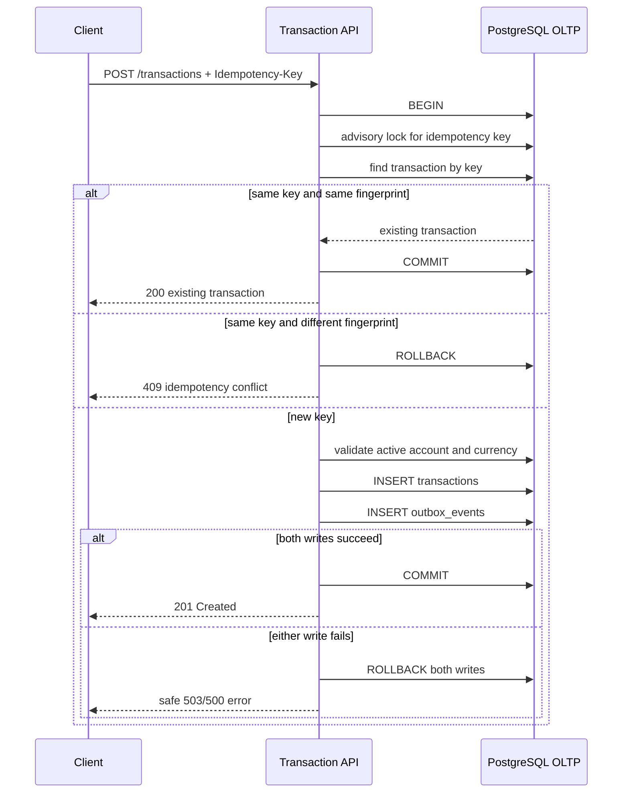
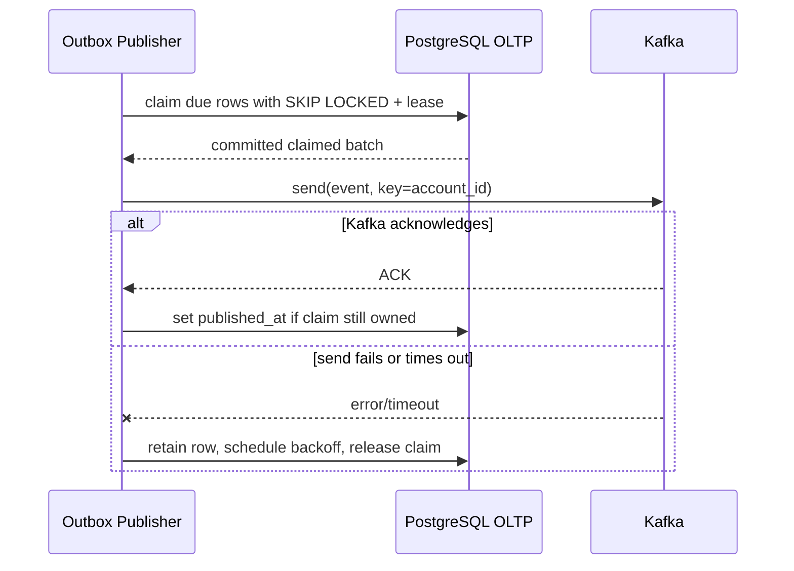
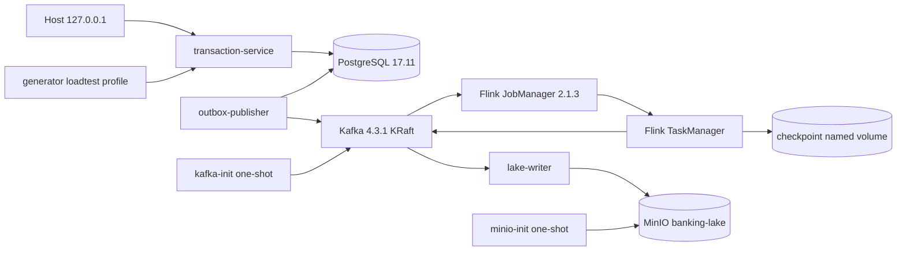

# Architecture

The target architecture and failure boundaries are described in `docs/IMPLEMENTATION.md`, section 3. The implemented vertical slice now covers the transaction API, outbox publication, Kafka infrastructure, Flink streaming and MinIO data lake through Phase 6.

## Transaction API and transactional outbox

The advisory lock is transaction-scoped and keyed by a deterministic PostgreSQL hash of the globally scoped idempotency key. The unique constraint on `transactions.idempotency_key` remains the final database invariant.

## Outbox claim, publish and retry

The database claim transaction ends before network I/O. A claim token prevents a stale worker from completing another worker's row, while an expiring lease makes abandoned work recoverable. Delivery is at least once: a crash after Kafka ACK and before `published_at` can produce a duplicate, so Phase 5 consumers must deduplicate by `event_id`.

Required diagrams:

1. API transaction plus transactional outbox — implemented and integration-tested.
2. Outbox-to-Kafka publish and retry — implemented and integration-tested.
3. Kafka-to-Flink validation/fraud/aggregation — implemented and tested with checkpoint recovery.
4. Lake sink idempotency and replay — implemented and tested; warehouse sink remains planned.
5. Batch reconciliation and report publication — planned.

## Phase 4–6 local runtime topology

Kafka has separate listeners for the Docker network (`kafka:9092`) and the host (`localhost:9092`). Auto topic creation is disabled; the one-shot init service applies the checked-in topic manifest before producers and Flink start. PostgreSQL, Kafka and Flink checkpoint state use named volumes and are preserved by a normal `docker compose down`.

The Phase 5 application has stable operator UIDs and this order: validate → deduplicate by `event_id` → assign bounded-out-of-order watermarks → route too-late events → validated/fraud/aggregate Kafka sinks. Idle Kafka partitions stop holding back the global watermark after the configurable `WATERMARK_IDLENESS` interval. The normal source mode resumes committed offsets with an earliest fallback; `LATEST` is available only for explicit isolated bootstrap/smoke runs. Validation failures retain only a payload hash and source coordinates. `HIGH_VALUE` applies to VND amounts at or above 100,000,000; `VELOCITY_60S` emits when an account exceeds 10 deduplicated events in a sliding 60-second window. One-minute aggregates remain separated by currency.

Kafka sinks use transactions tied to Flink checkpoints. This covers replay caused by a TaskManager failure inside the streaming job; it does not make later lake or warehouse writes exactly once. Those consumers must still upsert by deterministic IDs in Phases 6–7.

## Phase 6 lake commit flow

The lake writer reads the raw and validated topics with separate consumer groups. Raw batches become compressed JSONL in `bronze/transactions/ingest_date=...`; each row preserves the exact payload bytes plus topic, partition, offset, Kafka timestamp and SHA-256. Validated batches become typed Avro-backed Parquet in `silver/transactions/event_date=...` and daily aggregate partials in `gold/daily_transactions/report_date=...`.

The writer derives a deterministic batch ID from layer, source offsets and payload hashes. It writes and verifies all data objects first, writes `_manifests/{layer}/batch_id=...json` last as the commit marker, and commits Kafka offsets only after storage succeeds. Reprocessing the same records therefore reuses byte-identical objects; an existing key with a different checksum is treated as corruption/collision and fails closed. This protocol provides replay-safe local object publication, not a distributed exactly-once claim. Gold files are deliberately marked partial until Phase 8 performs deterministic daily compaction.
