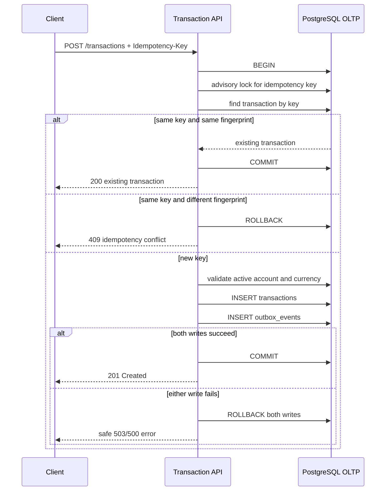
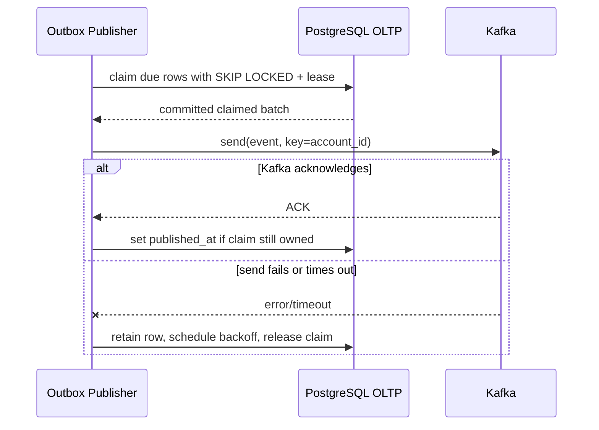
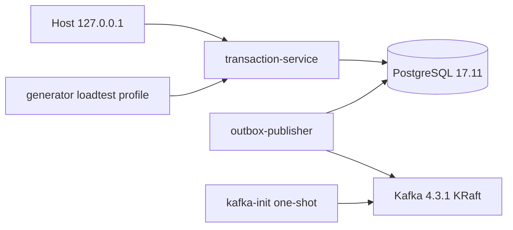

# Architecture

The target architecture and failure boundaries are described in `docs/IMPLEMENTATION.md`, section 3. The implemented vertical slice now covers the Phase 2 transaction API and the Phase 3 generator/outbox publisher.

## Transaction API and transactional outbox

The advisory lock is transaction-scoped and keyed by a deterministic PostgreSQL hash of the globally scoped idempotency key. The unique constraint on `transactions.idempotency_key` remains the final database invariant.

## Outbox claim, publish and retry

The database claim transaction ends before network I/O. A claim token prevents a stale worker from completing another worker's row, while an expiring lease makes abandoned work recoverable. Delivery is at least once: a crash after Kafka ACK and before `published_at` can produce a duplicate, so Phase 5 consumers must deduplicate by `event_id`.

Required diagrams:

1. API transaction plus transactional outbox — implemented and integration-tested.
2. Outbox-to-Kafka publish and retry — implemented and integration-tested.
3. Kafka-to-Flink validation/fraud/aggregation — planned.
4. Sink idempotency and replay — planned.
5. Batch reconciliation and report publication — planned.

## Phase 4 local runtime topology

Kafka has separate listeners for the Docker network (`kafka:9092`) and the host (`localhost:9092`). Auto topic creation is disabled; the one-shot init service applies the checked-in topic manifest before the publisher starts. PostgreSQL and Kafka state use named volumes and are preserved by a normal `docker compose down`.
