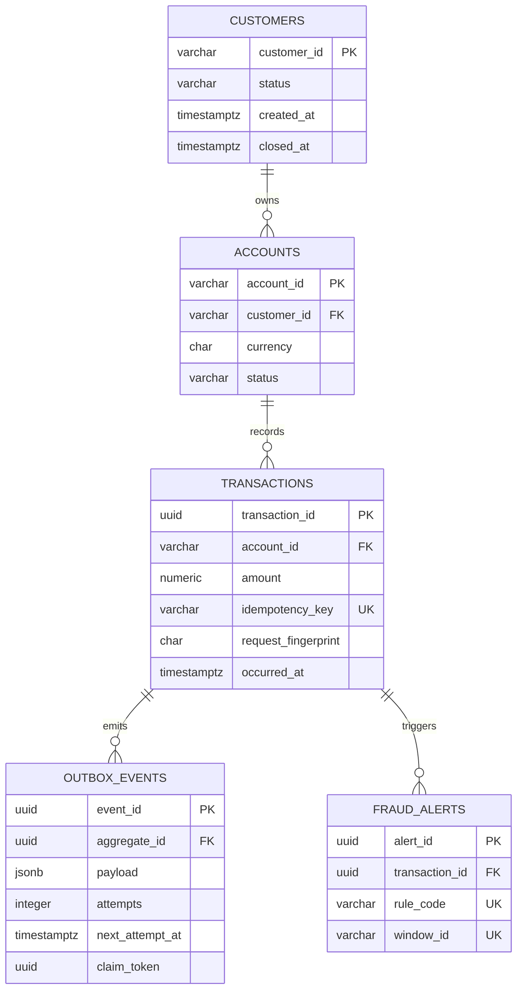
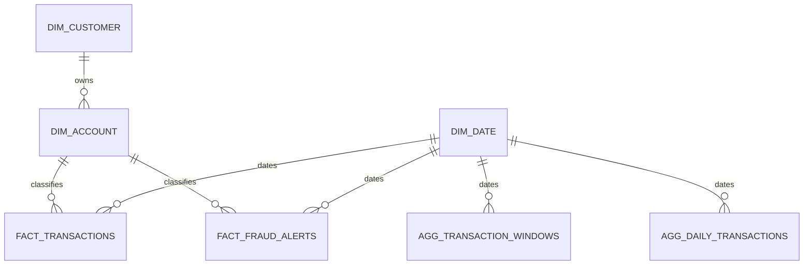

# Data Model

The platform uses physically separate OLTP and analytical PostgreSQL databases. Phase 1 owns the OLTP schema; Phase 7 owns the warehouse star schema.

`processing_runs` is an independent audit/reconciliation table holding source ranges, input/output counts, optional SHA-256 checksum, amount total, status and timing.

## Migration inventory

| Version | Purpose |
|---|---|
| `V1__create_core_banking_tables.sql` | Customers, accounts, transactions, transactional outbox and polling indexes |
| `V2__create_fraud_and_reconciliation_tables.sql` | Idempotent fraud alerts and processing run evidence |

The migrations live under `services/transaction-service/src/main/resources/db/migration` so Phase 2 can execute them through Flyway without copying schema definitions.

## Invariants

- Monetary values use `NUMERIC(19,2)` and must be greater than zero.
- ISO currency values must be three uppercase letters.
- `idempotency_key` is unique; `request_fingerprint` lets Phase 2 distinguish a safe retry from key reuse with a different payload.
- Outbox workers can only set `claim_token` together with `locked_until`; unpublished events are indexed by retry time.
- A fraud alert is unique by `(transaction_id, rule_code, window_id)` so replay cannot duplicate the same business alert.
- Completed or failed processing runs require `finished_at`; running records must not have one.

## Recovery policy

Migrations are forward-only. Never edit a migration that has run in a shared environment. Correct schema defects with a new migration. Before a production migration, take a database backup and record the Flyway state; recovery is restore-to-new-instance plus application rollback, not an ad-hoc reverse script.

The Phase 1 integration test starts an empty PostgreSQL 17.11 instance, applies both migrations and exercises unique and check constraints. When Docker is unavailable, the test is explicitly skipped rather than reported as passed; the resource-level migration test still runs.

## Warehouse star schema (Phase 7)

`fact_transactions` has exactly one row per `transaction_id`; `event_id` is also unique. `fact_fraud_alerts` has one row per `alert_id` and links to a transaction when the referenced event has already arrived. `agg_transaction_windows` stores the streaming one-minute grain keyed by `aggregate_id`/`window_key`. `agg_daily_transactions` has the final `(date_key, currency)` grain but remains empty until Phase 8 writes it with an audited `batch_run_id`.

`processed_kafka_records` is the delivery ledger. `warehouse_rejections` retains malformed raw bytes, while `warehouse_dlq_outbox` guarantees that quarantine and DLQ intent commit atomically with the consumed offset. `warehouse_reconciliation_runs` persists source ranges, raw/valid/invalid/unique and inserted/updated/rejected counts, duplicate deliveries, source/accepted totals per currency, and amount deviation.

Because the v1 transaction event has `account_id` but no customer attributes, a missing account is inferred and linked to the explicit `UNKNOWN` customer. All contract-valid uppercase three-letter currencies are accepted and measured independently; cross-currency sums are forbidden without an explicit exchange-rate model. Once inferred, an account's currency is immutable in this writer; a conflicting event is quarantined and counted as rejected instead of silently rewriting the dimension.
