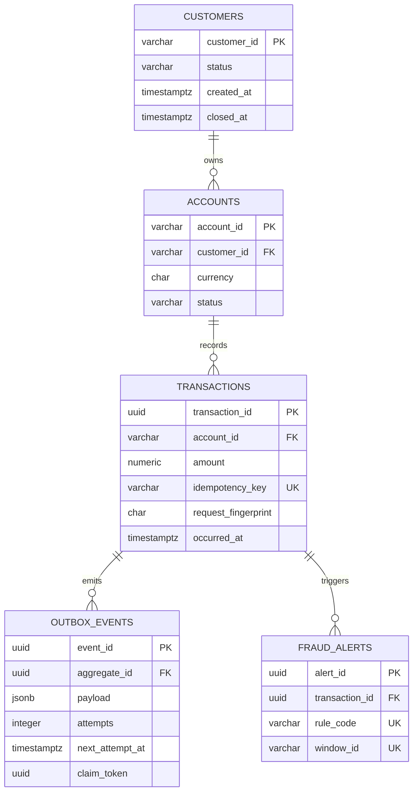

# Data Model

Phase 1 introduces the OLTP schema used by the future transaction API and outbox publisher. It is deliberately separate from the analytical star schema planned for Phase 7.

`processing_runs` is an independent audit/reconciliation table holding source ranges, input/output counts, optional SHA-256 checksum, amount total, status and timing.

## Migration inventory

| Version | Purpose |
|---|---|
| `V1__create_core_banking_tables.sql` | Customers, accounts, transactions, transactional outbox and polling indexes |
| `V2__create_fraud_and_reconciliation_tables.sql` | Idempotent fraud alerts and processing run evidence |

The migrations live under `services/transaction-service/src/main/resources/db/migration` so Phase 2 can execute them through Flyway without copying schema definitions.

## Invariants

- Monetary values use `NUMERIC(19,2)` and must be greater than zero.
- ISO currency values must be three uppercase letters.
- `idempotency_key` is unique; `request_fingerprint` lets Phase 2 distinguish a safe retry from key reuse with a different payload.
- Outbox workers can only set `claim_token` together with `locked_until`; unpublished events are indexed by retry time.
- A fraud alert is unique by `(transaction_id, rule_code, window_id)` so replay cannot duplicate the same business alert.
- Completed or failed processing runs require `finished_at`; running records must not have one.

## Recovery policy

Migrations are forward-only. Never edit a migration that has run in a shared environment. Correct schema defects with a new migration. Before a production migration, take a database backup and record the Flyway state; recovery is restore-to-new-instance plus application rollback, not an ad-hoc reverse script.

The Phase 1 integration test starts an empty PostgreSQL 17.11 instance, applies both migrations and exercises unique and check constraints. When Docker is unavailable, the test is explicitly skipped rather than reported as passed; the resource-level migration test still runs.
